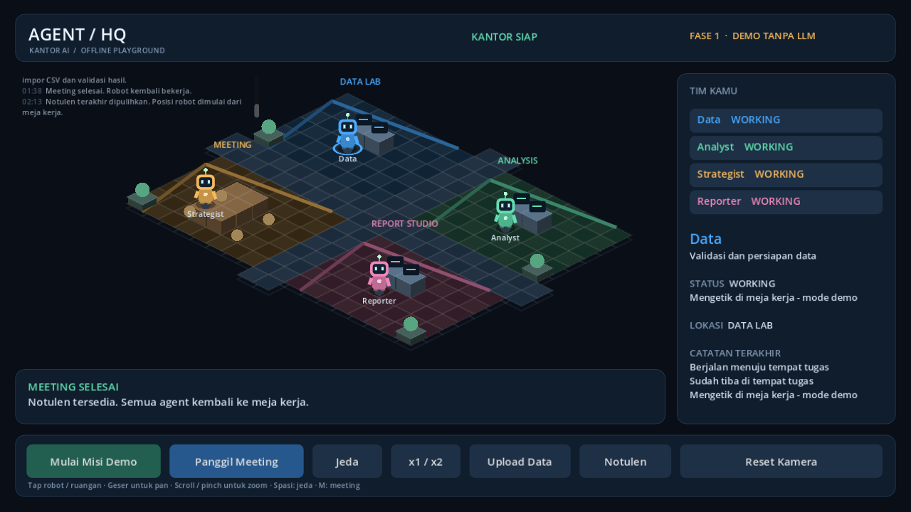

# Agent AI Mobile — Agent HQ

Game kantor AI 2D isometric untuk Android landscape, mengikuti PRD di repositori ini. Target perangkat: Infinix GT 20 Pro / X6871. **Versi saat ini: Fase 2, impor CSV dan analisis lokal; inferensi LLM belum aktif.**



## Yang tersedia

- Empat ruangan dengan meja, monitor, koridor dan kursi meeting.
- Empat robot berwarna berbeda: Data, Analyst, Strategist, Reporter.
- Animasi prosedural idle, berjalan, duduk, mengetik dan berbicara.
- AStarGrid2D dengan rute empat arah, collision grid, reservasi tile dan kursi unik.
- Tombol Panggil Meeting: semua agent berjalan ke kursi, menunggu tim lengkap, berdialog bergiliran, lalu kembali ke meja.
- Misi demo, panel status per agent, log, notulen, pause/resume, animasi x1/x2, pan dan zoom.
- Notulen terakhir disimpan lokal. Saat aplikasi dibuka ulang, robot mulai di meja kerja; misi berjalan belum dipulihkan.
- Mode demo sepenuhnya offline tanpa model, akun, atau akses jaringan.
- Impor CSV lokal lewat pemilih dokumen Android, batas 20 MB dan 100.000 baris; file tidak diunggah.
- KPI total/rata-rata omzet, tren bulanan, ranking 5 produk, serta pratinjau 5 baris. Kolom Indonesia/Inggris dikenali otomatis; format angka Indonesia didukung.
- Analisis CSV berjalan di thread latar belakang agar UI kantor tetap responsif. XLSX, pemetaan kolom manual, ekspor, dan LLM belum tersedia.

**Batas analisis:** sistem menghitung omzet dari kolom `revenue/pendapatan/total/omzet/sales`, atau `qty/jumlah × harga/price`. `diskon` dan pajak belum dihitung. Header tanggal dan produk dipakai untuk pengelompokan; bila tidak ada, hasil tetap menampilkan total dan menandai data tanpa nama/tanggal.

## Preview langsung di HP

Jika build cloud berhasil: buka **Actions → Android demo → run terbaru → Artifacts → AgentHQ-Android**. Unduh ZIP di HP, ekstrak, lalu instal `AgentHQ-demo.apk`. Izinkan instalasi dari aplikasi yang dipakai membuka APK jika Android meminta. Akun GitHub dengan akses repo diperlukan untuk mengunduh artifact.

Build ini adalah APK debug untuk pengujian, bukan rilis Play Store. Uji di HP tetap diperlukan untuk menilai FPS, layout, sentuhan dan lifecycle. Tidak perlu memasang LLM untuk memainkan Fase 1.

Untuk build lokal dan deploy lewat USB: [Panduan Android](docs/ANDROID_BUILD.md).

## Jalankan di laptop

Gunakan **Godot 4.5.1 Standard**, bukan .NET. Buka `game/project.godot`, lalu tekan F6/F5 untuk menjalankan scene/proyek. Semua aset dibuat dengan primitive drawing Godot; tidak ada paket aset eksternal.

Pada workspace yang sudah disiapkan:

```powershell
powershell -ExecutionPolicy Bypass -File .\scripts\Play.ps1
powershell -ExecutionPolicy Bypass -File .\scripts\Test.ps1
```

Jika kebijakan PowerShell laptop melarang file `.ps1`, jalankan lewat editor Godot. Tidak perlu mengubah kebijakan keamanan Windows.

Untuk workspace ini, bisa juga klik dua kali `scripts/Play.cmd` untuk membuka game di laptop.

Kontrol: tap/klik robot untuk detail, tap ruangan untuk daftar agent, geser untuk pan, scroll/pinch untuk zoom, Spasi untuk jeda, M untuk meeting. x2 mempercepat simulasi demo; bukan pengaturan kecepatan LLM.

## LLM untuk HP

Pilihan prototipe: **Qwen3 1.7B GGUF Q4_K_M + llama.cpp di Termux**. Setelah benchmark stabil, bandingkan dengan Qwen3 4B Q4 sesuai PRD. Empat agent memakai satu model secara serial. Integrasi ke game belum aktif pada Fase 1.

Folax tetap dapat digunakan sebagai asisten HP. Proyek ini belum memiliki API/SDK resmi Folax yang bisa diandalkan untuk inferensi offline dari aplikasi lain. Kami tidak mengasumsikan bahwa model Folax dapat dipanggil oleh Godot.

Lihat [setup dan benchmark LLM](docs/LLM_PHONE.md), [arsitektur](docs/ARCHITECTURE.md), serta [status verifikasi](docs/VALIDATION.md).

## Struktur

```text
game/                 Proyek Godot dan preset Android arm64
game/scripts/         Map, agent, meeting, UI dan state aplikasi
tests/                Uji navigasi/simulasi dan UI smoke test
scripts/              Perintah PowerShell untuk play, test, build dan deploy
docs/                 Panduan, batasan dan checklist perangkat nyata
.github/workflows/    Build APK debug di GitHub Actions
```

Folder `.tools`, `build`, cache Godot, model GGUF dan keystore tidak masuk Git. Download awal tool membutuhkan internet. Analisis data yang terpasang berjalan offline.
